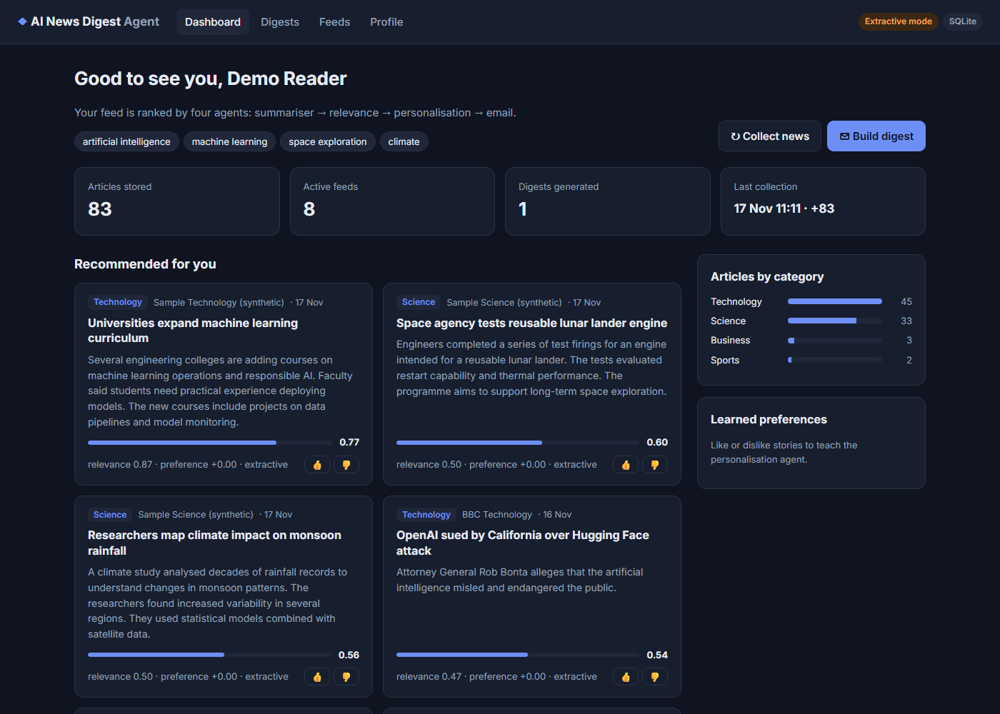
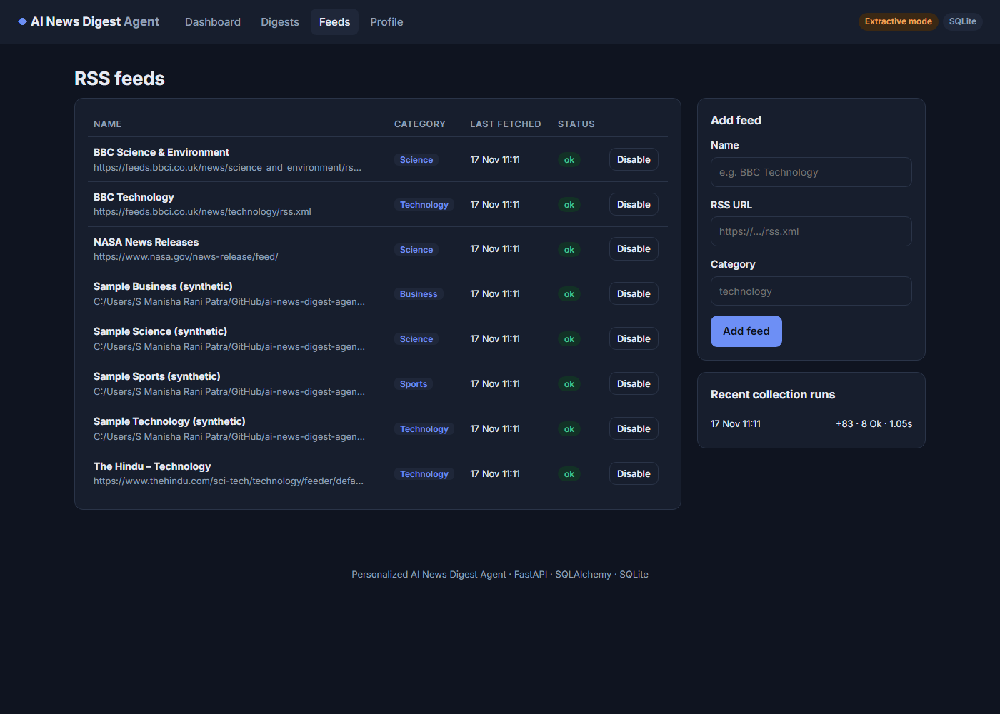
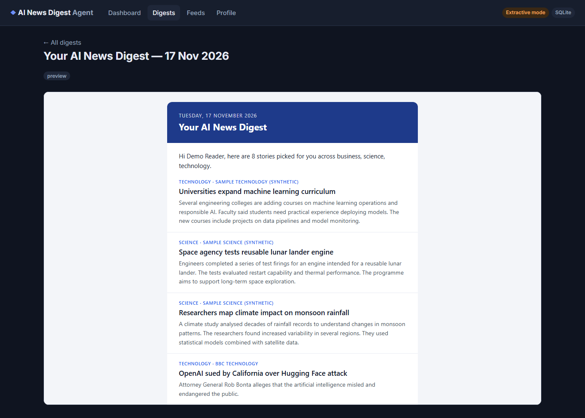

# Personalized AI News Digest Agent

A multi-agent system that collects news from RSS feeds, summarises each article, ranks stories by a reader's interests, learns from 👍/👎 feedback, and produces a personalised HTML email digest. It has a web dashboard and a JSON API.

**Tech stack:** Python 3.11 · FastAPI · SQLAlchemy 2 · PostgreSQL (SQLite fallback) · OpenAI API (optional) · feedparser · scikit-learn · Jinja2 · Docker · Render



## Problem statement & objectives

Readers follow many news sources and cannot read everything; generic feeds are not ranked by what each reader cares about.
This project aims to:
1. collect articles automatically from many RSS/Atom (and YouTube channel) feeds;
2. summarise each article, with an LLM when available and an offline extractive method otherwise;
3. rank articles by each reader's stated interests and learn from their 👍/👎 feedback;
4. deliver the result as a personalised HTML email digest, a web dashboard and a JSON API.

## Features

| Feature | How it works |
|---|---|
| Multi-feed RSS collection | `feedparser` over any number of RSS/Atom feeds. The default list has **18 real sources**: BBC, NASA, MIT Technology Review, TechCrunch, Ars Technica, arXiv cs.AI, Hugging Face and others, plus **5 YouTube channel feeds** (3Blue1Brown, StatQuest, Two Minute Papers, sentdex, freeCodeCamp). There are also 4 offline sample feeds. Duplicates are skipped by link. A broken feed is logged, and the rest still run. |
| Article extraction | Optional full-page extraction with BeautifulSoup (`FETCH_FULL_ARTICLES=true`). Falls back to the RSS description. |
| **Summarizer agent** | Uses the OpenAI Chat Completions API when `OPENAI_API_KEY` is set, or any OpenAI-compatible endpoint (`OPENAI_BASE_URL`, e.g. local Ollama). Otherwise it uses a local extractive summariser (TF-IDF centroid). Each summary records which method produced it. |
| **Relevance agent** | Scores each article against the reader's interests using TF-IDF cosine similarity plus keyword overlap, giving a score from 0 to 1. |
| **Personalization agent** | Learns category and keyword weights from feedback. Ranks articles by relevance, learned preference and recency (exponential decay). Caps stories per source and removes near-duplicate titles. |
| **Email agent** | Renders a responsive HTML email. Sends via SMTP if configured; otherwise stores a preview you can view in the UI. |
| Database | PostgreSQL through SQLAlchemy ORM (feeds, articles, profiles, feedback, digests, pipeline runs). Uses SQLite automatically when no `DATABASE_URL` is set. |
| Web interface | Dashboard, Digests, Feeds and Profile pages. Responsive, with light and dark themes. |
| Deployment | `Dockerfile`, `docker-compose.yml` (app + Postgres) and a `render.yaml` blueprint. |

## Workflow

1. **Collect:** `rss_collector.py` reads every enabled feed and stores new articles (duplicates skipped by link).
2. **Summarise:** the summarizer agent writes a summary per article (LLM, or TF-IDF centroid extractive fallback).
3. **Score:** the relevance agent scores each article against the reader's interests (TF-IDF cosine + keyword overlap).
4. **Personalise:** the personalization agent combines relevance, weights learned from feedback and recency, caps stories per source and removes near-duplicates.
5. **Deliver:** the email agent renders the digest as HTML and sends it via SMTP, or stores a preview in the UI.

`app/pipeline.py` orchestrates these steps; every run is recorded in the database.

## Project structure

```
ai-news-digest-agent/
├── app/
│   ├── agents/            # summarizer.py, relevance.py, personalization.py, email_agent.py
│   ├── ingestion/         # rss_collector.py, extractor.py
│   ├── web/               # main.py (FastAPI), templates/, static/
│   ├── config.py          # env-based settings
│   ├── database.py        # engine + session handling
│   ├── models.py          # SQLAlchemy ORM models
│   ├── llm.py             # OpenAI wrapper (never raises; enables fallback)
│   ├── pipeline.py        # orchestrator for the agents
│   └── text_utils.py
├── data/
│   ├── feeds.json         # default feeds (4 synthetic local + 18 real, incl. 5 YouTube channels)
│   └── sample_feeds/      # SYNTHETIC demo RSS files (not real news)
├── docs/ARCHITECTURE.md, docs/screenshots/
├── scripts/make_sample_feeds.py
├── tests/                 # pytest suite (runs fully offline)
├── Dockerfile, docker-compose.yml, render.yaml
├── requirements.txt, .env.example, pytest.ini
```

## Installation (local)

```bash
git clone https://github.com/manisha2001-20/ai-news-digest-agent.git
cd ai-news-digest-agent
python -m venv .venv
# Windows: .venv\Scripts\activate      macOS/Linux: source .venv/bin/activate
pip install -r requirements.txt
cp .env.example .env        # optional: add OPENAI_API_KEY, DATABASE_URL, SMTP_*
```

## Running

```bash
uvicorn app.web.main:app --reload --port 8000
```

Open http://localhost:8000 and click **Collect news**, then **Build digest**.

The first start creates the database, the default feeds and a "Demo Reader" profile. Without an OpenAI key, the pill in the top bar reads **Extractive mode**.

### With Docker + PostgreSQL

```bash
cp .env.example .env
docker compose up --build
```

### Deploy to Render

Push the repo to GitHub, then go to Render and choose **New → Blueprint** and select the repo. `render.yaml` creates the web service and a PostgreSQL database. Set `OPENAI_API_KEY` in the Render dashboard.

> **Deployment status:** the Docker and Render configuration is included and structurally validated, but it has **not been executed** yet: Docker was not available on the development laptop and no Render account was connected. PostgreSQL support *is* tested against a real PostgreSQL 16 server (see below). Step-by-step instructions are in [docs/DEPLOYMENT.md](docs/DEPLOYMENT.md).

## API

| Method | Path | Description |
|---|---|---|
| GET | `/api/health` | Health check (DB, LLM and SMTP status) |
| POST | `/api/run` | Collect feeds and summarise new articles |
| GET | `/api/users/{id}/feed?k=10` | Ranked articles with score breakdown |
| POST | `/api/feedback` | `{"user_id":1,"article_id":5,"value":1}` (value must be 1 or -1) |
| POST | `/api/users/{id}/digest?send=false` | Build (and optionally email) a digest |

Interactive docs are at `/docs` (Swagger UI).

## Tests

```bash
pytest
```

The tests cover:
- the agents and RSS parsing, including the YouTube channel feed format;
- error handling (missing feed, invalid feedback, unknown user, bad URL);
- pipeline idempotency and digest generation;
- every web page and API endpoint;
- the LLM path (mocked OpenAI client, with a fallback when the API fails).

By default they use the synthetic local feeds and a temporary SQLite database, so they need no network or API key.

Optional extras:

```bash
pip install -r requirements-dev.txt   # embedded PostgreSQL (pgserver), no Docker needed
pytest                                # also runs tests/test_postgres_integration.py against real PostgreSQL
```

`tests/test_llm_agents.py::test_live_summary_via_openai_compatible_endpoint` also runs a live LLM summary when a local Ollama server is reachable. On the author's machine all **34 tests pass**, including PostgreSQL and the live LLM test.

## Screenshots

| Dashboard | Feeds | Digest preview |
|---|---|---|
|  |  |  |

To retake them: run the app, collect news, build a digest, then capture `/`, `/feeds` and `/digests/1` with your browser's screenshot tool (or `msedge --headless=new --screenshot=out.png --window-size=1400,1000 http://localhost:8000/`).

## Notes and limitations

- Files in `data/sample_feeds/` are **synthetic** and exist only so the app and tests work offline.
- The extractive fallback picks existing sentences and does not paraphrase. Quality is better with an OpenAI key.
- Relevance uses TF-IDF, not neural embeddings. This keeps it lightweight and CPU-only.
- Article text is treated as data: the LLM prompt tells the model to ignore any instructions inside articles.

See [docs/ARCHITECTURE.md](docs/ARCHITECTURE.md) for the design.
